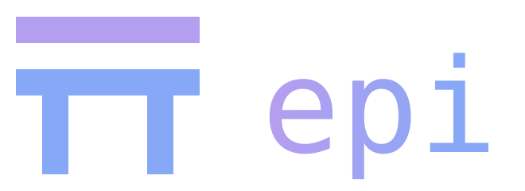
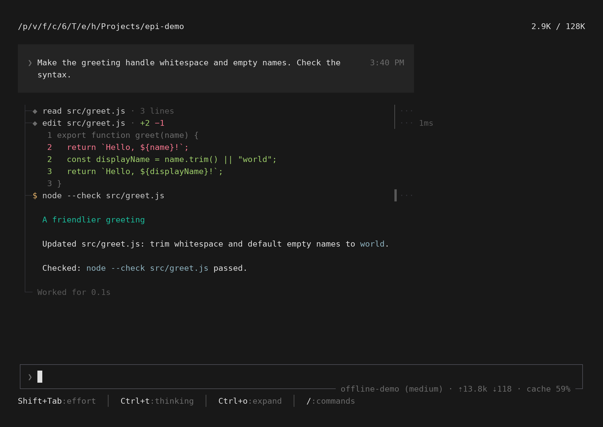
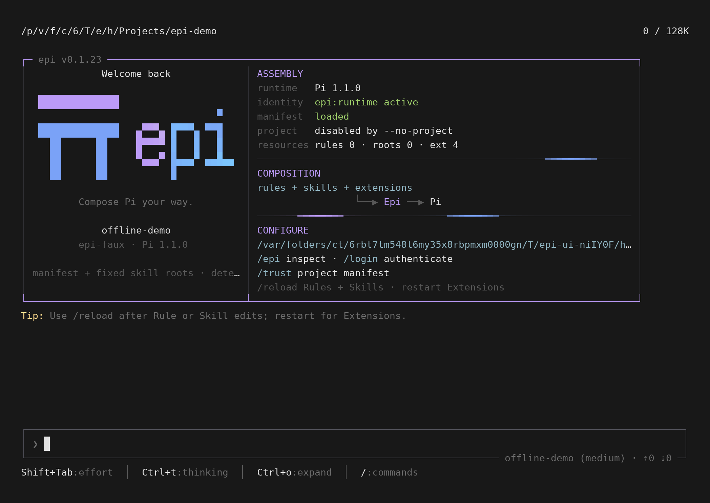
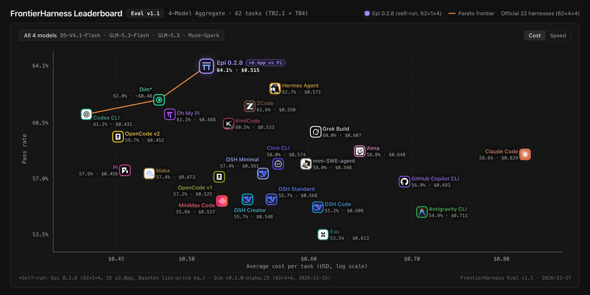

<p align="center">
  <picture>
    <source media="(prefers-color-scheme: light)" srcset="docs/assets/epi-logo-light.svg">
    
  </picture>
</p>

# Epi

> Compose Pi your way.

epi- 是希腊语前缀"在……之上"，Epi 是建在 Pi 之上的那一层。

Epi 是基于 Pi SDK 的可定制终端编程助手。自有 grok 风格 TUI，组合 Skills、MCP、Hooks 与隔离子任务；Pi 提供模型、Agent Loop 与 Session，Epi 管理界面、配置、信任和能力装配。



*真实 TUI，离线演示数据。思考、文件修改与命令执行集中呈现。*

<details>
<summary>查看启动页</summary>



[截图生成方式](docs/assets/README.md)

</details>

## 要点

- **自有界面**：按 grok-build 设计的全屏终端界面，对话、思考、工具调用和文件修改集中呈现。
- **建在 Pi 上**：模型、Agent Loop、Session 用锁定版本的 Pi SDK，功能和 Pi 对齐。
- **配置只属于 Epi**：独立的 `~/.epi`，不读 Pi 或其他工具的配置，不认 `PI_*` 环境变量；项目配置要先信任。
- **显式装配**：Rules、Skills、Extensions 由 Manifest 声明；内建 Task（子任务）、MCP、Hooks 默认开启，可以关掉。
- **不用离开终端去审查**：`/preview` 看 agent 改了什么，`/review` 连续审查多个文件并写批注，`/trace` 看这次到底执行了什么、花了多久。

## Benchmark（FrontierHarness Eval v1.1）

在 [FrontierHarness Eval v1.1](https://frontierharness.org)（62 题：TB2.1 45 题 + TB4 17 题）上，对 `epi 0.2.8`（锁定 Pi SDK `1.4.0`、默认内建扩展全开）在 4 个主流开源模型上各跑了全量 62 题单次评测（`62 × 1 × 4 = 248` 次有效计分，`infra = 0`）。**四模型均分 64.1%（159/248）**，在全部 4 个模型上均超过底层原生 Pi `1.4.0`（均分 57.6%，提升 **+6.6pp**）。

<p align="center">
  <picture>
    <source media="(prefers-color-scheme: light)" srcset="docs/assets/benchmark-frontier-light.png">
    
  </picture>
</p>

### 四模型综合对比

| Harness | 来源 / 样本 | 四模型均分 | DS-V4.1-Flash | GLM-5.3-Flash | GLM-5.3 | Muse-Spark | 均成本 / 题 | 每通过成本 |
|---|---|---:|---:|---:|---:|---:|---:|---:|
| **Epi 0.2.8** | 自测 `62×1×4` (248) | **64.1%** | **69.4%** | **67.7%** | **64.5%** | **54.8%** | **$0.515** | **$0.804** |
| Hermes Agent | 官方 `62×4×4` (992) | 62.7% | 64.5% | 63.7% | 59.7% | 62.9% | $0.571 | $0.911 |
| Dim `v0.1.0-alpha.25` | 自测 `62×4×4` (992) | 62.0% | 68.5%* | — | — | — | ~$0.48 | ~$0.77 |
| ZCode | 官方 `62×4×4` (992) | 61.6% | 69.0% | 60.9% | 58.9% | 57.7% | $0.550 | $0.893 |
| Oh My Pi | 官方 `62×4×4` (992) | 61.1% | 62.9% | 59.3% | 57.7% | 64.5% | $0.488 | $0.799 |
| Codex CLI | 官方 `62×4×4` (992) | 61.1% | 69.4% | 59.3% | 58.1% | 57.7% | $0.431 | $0.705 |
| KimiCode | 官方 `62×4×4` (992) | 60.5% | 66.9% | 60.1% | 58.5% | 56.5% | $0.533 | $0.881 |
| Grok Build | 官方 `62×4×4` (992) | 60.0% | 68.1% | 55.6% | 56.5% | 59.7% | $0.607 | $1.011 |
| OpenCode 2.2.7 | 官方 `62×4×4` (992) | 59.7% | 67.7% | 55.6% | 52.0% | 63.3% | $0.452 | $0.757 |
| Claude Code | 官方 `62×4×4` (992) | 58.6% | 69.0% | 57.3% | 54.8% | 53.2% | $0.829 | $1.416 |
| **Pi 1.4.0**（底层 SDK） | 官方 `62×4×4` (992) | 57.6% | 63.7% | 58.1% | 56.5% | 52.0% | $0.456 | $0.792 |

### Epi 分模型明细

| 模型 | 通过率（62×1） | 较 Pi 1.4.0 | TB2.1（45 题） | TB4（17 题） | 缓存命中 | 工具调用 | Baseten 等效 / 题 |
|---|---:|---:|---:|---:|---:|---:|---:|
| DeepSeek-V4.1-Flash-1017 | **69.4%** (43/62) | **+5.6pp** | 84.4% (38/45) | 29.4% (5/17) | 97.5% | 3,602 | $0.167 |
| GLM-5.3-Flash | **67.7%** (42/62) | **+9.7pp** | 84.4% (38/45) | 23.5% (4/17) | 96.5% | 3,090 | $0.126 |
| GLM-5.3 | **64.5%** (40/62) | **+8.1pp** | 77.8% (35/45) | 29.4% (5/17) | 96.9% | 2,698 | $0.923 |
| Muse-Spark-1.2 | **54.8%** (34/62) | **+2.8pp** | 75.6% (34/45) | 0.0% (0/17) | 97.0% | 2,622 | $0.846 |
| **四模型合计** | **64.1%** (159/248) | **+6.6pp** | **80.6%** (145/180) | **20.6%** (14/68) | **97.0%** | **12,012** | **$0.515** |

<details>
<summary>评测口径与可复现说明</summary>

- **采样与误差**：Epi 为本机单次采样（`62×1×4 = 248`，四模型汇总二项标准误约 `±3.0pp`）；官方榜单基线取自 FrontierHarness 2026-11-26 实时数据（22 个 harness，`62×4×4 = 992`）；Dim `v0.1.0-alpha.25` 为其 2026-11-25 公开的独立自测结果（`62×4×4 = 992`，`*` 其 DeepSeek-V4.1-Flash-1017 68.5% 来自 2026-11-18 公开数据，其余三模型未单独披露）。
- **环境与参数**：Epi 运行于本机 OrbStack Docker 容器 + 本地 Magpie 网关（DeepSeek-V4.1-Flash-1017、GLM-5.3-Flash、GLM-5.3 使用 `--thinking max`，Muse-Spark-1.2 使用 `--thinking xhigh`）；官方榜单运行于 Runta + Baseten。评测期间出现的 4 次容器/npm 瞬态安装报错已单独补跑清零（`infra = 0`），13 次模型超时全部按失败计分未重跑。
- **成本口径**：上表「均成本 / 题」与「每通过成本」均按与官方一致的 Baseten 公开单价折算以便横向比较；4 模型累计输入 `961.5M` tokens（缓存命中 `97.0%`）、输出 `14.50M` tokens，本地 Magpie 实际计费 `$152.35`。

</details>

## 快速开始

```bash
curl -fsSL https://github.com/RoacherM/epi/releases/latest/download/install.sh | bash
epi
```

无需预装 Node.js 或 npm（支持 macOS 与 Linux；复用本机已有的 Bun，没有时自动下载校验过的私有 Bun 到 `~/.epi/runtime/bun`）。启动后用 `/login` 登录模型服务。

## 文档

- [更新记录](CHANGELOG.md)：各版本变更说明（最新：`0.2.10`）
- [使用文档](docs/guide/README.md)：[安装与升级](docs/guide/install.md) · [命令行](docs/guide/cli.md) · [配置](docs/guide/configuration.md) · [Preview](docs/guide/preview.md) · [Review](docs/guide/review.md) · [Trace](docs/guide/trace.md) · [Task](docs/guide/task.md) · [MCP](docs/guide/mcp.md) · [Hooks](docs/guide/hooks.md)
- [特性展示](docs/showcase/README.md)：每个版本的录屏与截图
- 开发：[架构设计（原则）](docs/architecture.md) · [实现与契约](docs/development.md) · [开发流程](docs/dev-workflow.md)（[通用的工作流图（wayne-skills 的 workflow-graph skill）](https://github.com/RoacherM/Wayne-Skills/blob/main/skills/workflow-graph/SKILL.md)） · [设计决策](docs/decisions.md)；给开发代理的入口是 [AGENTS.md](AGENTS.md)
