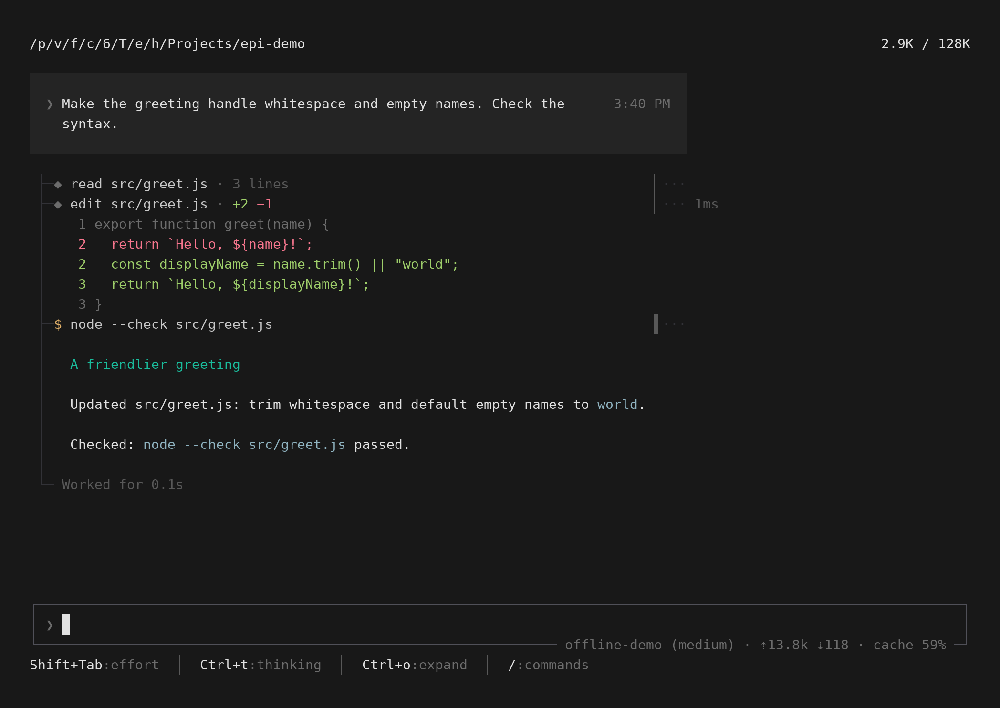
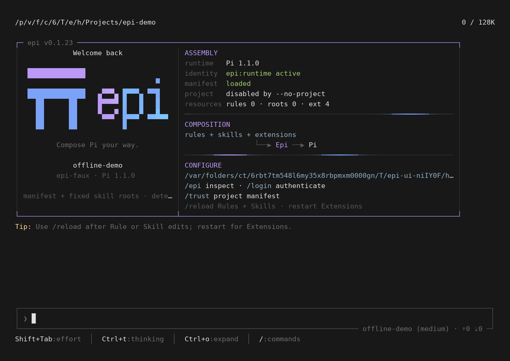

<p align="center">
  <picture>
    <source media="(prefers-color-scheme: light)" srcset="docs/assets/epi-logo-light.svg">
    
  </picture>
</p>

# Epi

> Compose Pi your way.

epi- 是希腊语前缀"在……之上"，Epi 是建在 Pi 之上的那一层。

Epi 是基于 Pi SDK 的可定制终端编程助手。自有 grok 风格 TUI，组合 Skills、MCP、Hooks 与隔离子任务；Pi 提供模型、Agent Loop 与 Session，Epi 管理界面、配置、信任和能力装配。



*真实 TUI，离线演示数据。思考、文件修改与命令执行集中呈现。*

<details>
<summary>查看启动页</summary>



[截图生成方式](docs/assets/README.md)

</details>

## 要点

- **自有界面**：按 grok-build 设计的全屏终端界面，对话、思考、工具调用和文件修改集中呈现。
- **建在 Pi 上**：模型、Agent Loop、Session 用锁定版本的 Pi SDK，功能和 Pi 对齐。
- **配置只属于 Epi**：独立的 `~/.epi`，不读 Pi 或其他工具的配置，不认 `PI_*` 环境变量；项目配置要先信任。
- **显式装配**：Rules、Skills、Extensions 由 Manifest 声明；内建 Task（子任务）、MCP、Hooks 默认开启，可以关掉。
- **不用离开终端去审查**：`/preview` 看 agent 改了什么，`/review` 连续审查多个文件并写批注，`/trace` 看这次到底执行了什么、花了多久。

## 最近更新

**0.1.22：对话区重新排版：回合脊柱、单行工具调用、限宽正文**

- **回合脊柱**：一轮对话左侧是一条连续的暗线：正文和思考在主干 `│` 上，每次工具调用是一条 `├─` 分支（失败为红色），`╰─ Worked for` 收尾。运行中只有脊柱末端几行有一道颜色脉冲往下走，工具或思考完成时对应那一段淡出闪烁。`/resume` 回放的历史也是同样的版式。
- **工具调用一行**：bash 用琥珀色 `$` 打头，去掉与当前目录相同的 `cd … &&`，家目录写成 `~`，heredoc 只显示首行加 `· +N lines`；读文件、搜索、编辑把行数、匹配数、`+3 −1` 写在调用行尾，后面是耗时。成功不再占一行 `exit 0`；失败才单独一行红色 `✗ exit 1 · 最后一行输出`。连续的工具调用之间不再空行。
- **思考**：折叠后是一行暗色的 `∴ 2.1s`（回放为 `∴ thought`），只在引出正文时显示，紧接工具调用的思考不再单独占行（耗时算进 `Worked for`）；`Ctrl+T` 仍然展开全部。回复右侧的时钟去掉了，时间只留在你的消息和 `Worked for` 上。
- **正文限宽**：回复正文每行最多 76 列，宽终端里更好读；代码块和表格仍按全宽显示。代码块不再露出 ```` ``` ```` 围栏行，改为左侧一条暗线加暗色语言标签（`text`/无语言不显示）；列表符号改为 `•`，行内代码和无高亮代码块的颜色调淡。
- 修复：底部 token 数超过百万时显示 `156M`、`1.2B`，不再是 `156186k`。
- 模型看到的内容没有变化（`model-snapshot` 无差异）。设计与实现记录见 [tui-transcript-layout-design.md](docs/tui-transcript-layout-design.md)、[tui-transcript-layout-implementation.md](docs/tui-transcript-layout-implementation.md)。

**0.1.21：工具块全文悬浮窗，统一的 Vim 移动键，克制的动效**

- **看工具块的完整输出**：`Ctrl+O` 展开后，单击 `read`、`bash`、`grep`/`find`/`ls`、`write`、`edit` 和 `!cmd` 块里的 `… N more lines`，在屏幕中间打开悬浮窗看全部内容：行号、`/` 搜索、`:120` 跳行、`w` 换行、`y` 复制，`q` / Esc 关闭。Pi 的 `read` 截断提示不再当成文件的一行，改写在标题里（`lines 1–955 of 1098 · 50.0KB limit`）。用法见 [命令行 · 看工具块的完整输出](docs/guide/cli.md#看工具块的完整输出)。
- **移动键统一（行为变化）**：悬浮窗、`/preview`、`/review`、`/trace` 用同一套键：`j`/`k` 可带数字（`10j`），**`gg` 到顶**（单个 `g` 不再到顶），`G` 到底，`120G` 跳到第 120 行，`b` / PageUp 上翻。例外：`/trace` 详情里数字仍是切栏目，`/preview` 文件列表里空格仍是标记。
- **动效**：启动页的 logo 流光和分割线脉冲只播约 4 秒开场就静止；运行中的工具、思考和 `!cmd` 块左侧竖轨有一道颜色脉冲往下走；完成时的绿色/红色闪烁改为 400ms 内淡出。状态行仍是原来的盲文 spinner。扩展可以用 `ctx.ui.setWorkingIndicator` 换掉它（以前会提示不支持）。
- 窄到 12 列时启动页的标题不再超出边框。
- 模型看到的内容没有变化（`model-snapshot` 无差异）。开发者：只读查看组件拆成了可复用的模块，组合方式见 [tui-buffer-components.md](docs/tui-buffer-components.md)。

**0.1.20：修复安装（0.1.19 装不上）**

0.1.19 全局安装后启动会报 `@earendil-works/pi-codemode` 缺少 `MCP_TYPESCRIPT_PREAMBLE`：npm 11 在全局安装 tarball 时忽略了包里的 `npm-shrinkwrap.json`，把 Pi 的传递依赖从 1.1.0 升到了不兼容的 1.3.0。0.1.20 把 Pi 的**全部传递依赖也在 `package.json` 里精确钉到 1.1.0**，并加了一个测试防再发。用 `epi update` 升到 0.1.20 即可；已装坏的 0.1.19 请重装或升级。

**0.1.19：执行轨迹（`/trace`）与连续代码审查（`/review`）**

- `/trace` 全屏看一次会话执行了什么：顶部是固定高度的点阵小地图，每个可见步骤一行、按时间定位、模型/工具/用户/事件各一色，选中的那一步反显高亮，大段空闲折成一个 `··`；下面是步骤列表和 Summary / Payload / Result / Schema / Timing 五个栏目。耗时区分「SDK 记录的响应/执行耗时」和「观察到的工具生命周期区间」，缺起止时只显示已记录的耗时，不伪造跨度；工具 Schema 按调用当时的声明回放。
- `/review` 全屏连续审查：多个文件的 diff 排在一页，gap 原地展开，`]c`/`[c` 跨文件跳改动，`.`/`,` 跳文件，`c` 给某一行写批注（绑定文件版本与旧/新侧，刷新后只在引用唯一匹配时移动，否则标 stale），`B` 把批注打包成草稿放回输入框，`s` 在「agent 变更账 / Index→Working Tree / HEAD→Index」之间切换。
- 两者都只在交互界面里加载，模型看不到（`model-snapshot` 无变化）。详细用法见 [Trace](docs/guide/trace.md) 与 [Review](docs/guide/review.md)。

**0.1.12：在 Epi 里看 agent 改了什么**

agent 改完文件后输入 `/preview`，直接看到改了哪些文件和每个文件的 diff，不用切到编辑器或 `git diff`。

```text
/preview          打开"改动"：agent 改过的文件，M 修改 / A 新建，右边是增删行数
回车              看这个文件的 diff；]c [c 跳到下一段、上一段改动
/needle  :120     在 diff 里搜索；跳到第 120 行
t                 只看上一轮的改动
d                 看完整文件
Tab               切到文件浏览
```

整页打开，最下面一行显示 agent 是否还在运行。只看不改：这一版没有编辑功能。完整说明见 [Preview](docs/guide/preview.md)。

**0.1.11：预览的小修正，以及命令不能重名**

- `/preview` 0.1.1：正在看的文件或目录被删后显示 `xxx not found`；读不了的目录说明原因，不再显示成空目录；名字里有换行的文件不插入引用，会提示。
- 两个扩展注册同名命令时（包括和内置的 `/preview`、`/mcp` 同名），Epi 启动就报错并说明是哪两个，而不是悄悄把它们改名成 `/xxx:1`、`/xxx:2`。

**0.1.10：在 Epi 里看文件（`/preview`）**

改完代码不用再切到编辑器去看结果。`/preview` 打开一个三栏的文件浏览器和查看器，能看带语法高亮的代码、渲染后的 Markdown、图片和视频。

```text
/preview                      在当前目录打开浏览器
/preview src/tui              在某个目录打开
/preview docs/architecture.md 直接打开一个文件（Markdown 会渲染，按 r 看源码）
/preview demo/clip.mp4        直接播放一个视频（需要本机有 ffmpeg）
```

在浏览器里用 `j`/`k` 移动、回车打开、`h` 回上级、`/` 过滤；按 `i` 把选中文件的 `@路径` 插进输入框，交给 agent 继续处理。图片和视频画面需要终端支持图形协议（Ghostty、kitty、iTerm2 等）。完整说明见 [Preview](docs/guide/preview.md)。

**0.1.9：`-p`、json、rpc 更稳**

- 机器忙时 `epi -p` 偶尔报 "No API key found for the selected model" 的问题修掉了。
- 项目里的 `.pi/settings.json` 不再能改会话的保存位置。
- 内置的 Magpie 网关每次启动都会同步模型列表，不管这次用的是哪个 provider。

## 快速开始

```bash
curl --proto '=https' --tlsv1.2 -fsSL \
  https://github.com/RoacherM/epi/releases/latest/download/install.sh | sh
epi
```

要求 Node.js `>=22.19.0`。启动后用 `/login` 登录模型服务。

## 文档

- [使用文档](docs/guide/README.md)：[安装与升级](docs/guide/install.md) · [命令行](docs/guide/cli.md) · [配置](docs/guide/configuration.md) · [Preview](docs/guide/preview.md) · [Review](docs/guide/review.md) · [Trace](docs/guide/trace.md) · [Task](docs/guide/task.md) · [MCP](docs/guide/mcp.md) · [Hooks](docs/guide/hooks.md)
- 开发：[架构设计（原则）](docs/architecture.md) · [实现与契约](docs/development.md) · [开发流程](docs/dev-workflow.md)（[自举流程](docs/dev-workflow-herdr.md)、[通用的工作流图（wayne-skills 的 workflow-graph skill）](https://github.com/RoacherM/Wayne-Skills/blob/main/skills/workflow-graph/SKILL.md)） · [设计决策](docs/decisions.md)；给开发代理的入口是 [AGENTS.md](AGENTS.md)
