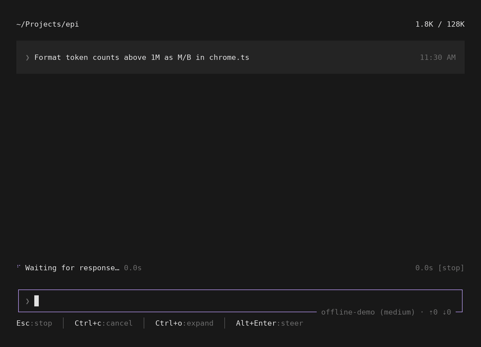
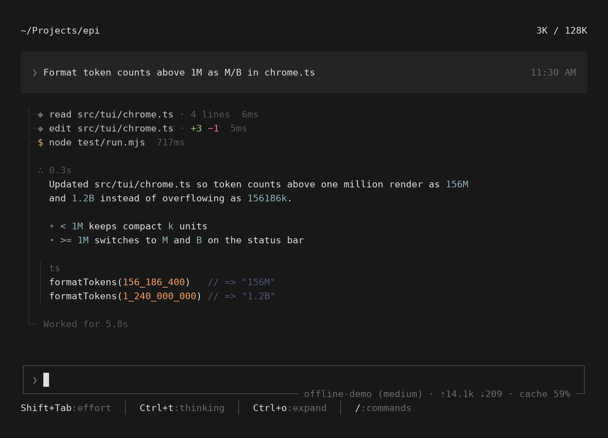
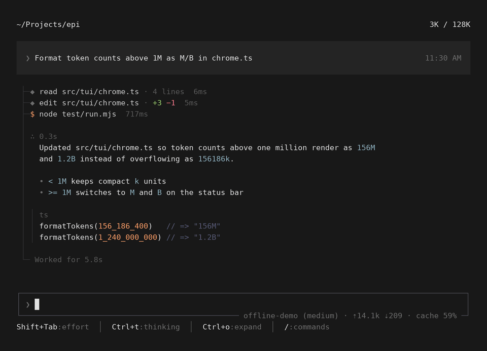
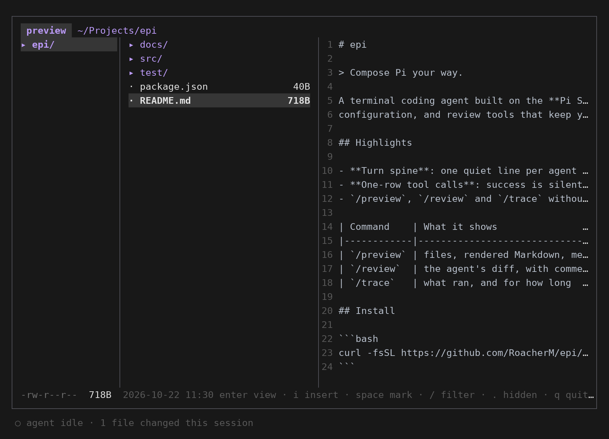
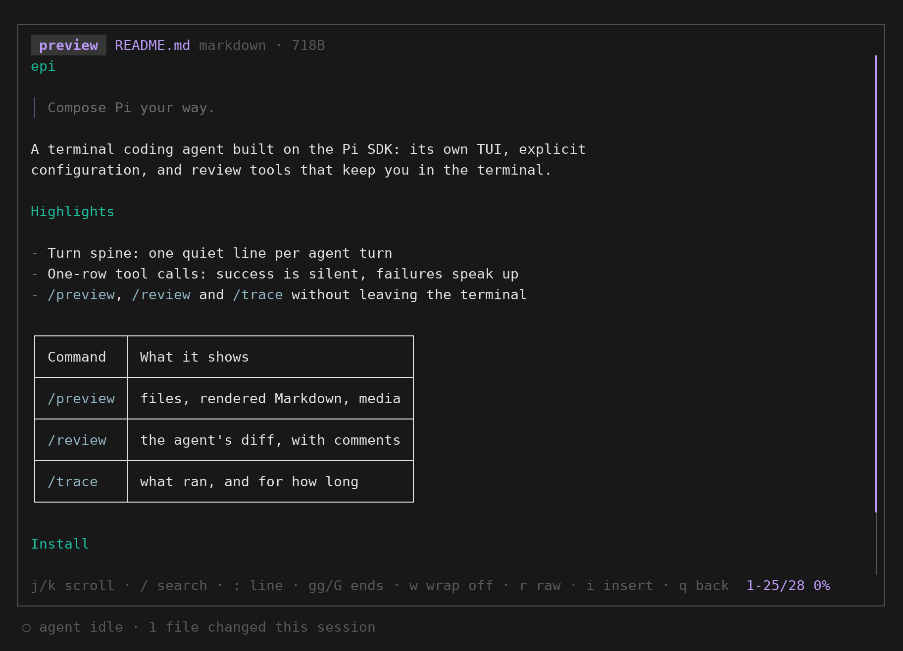
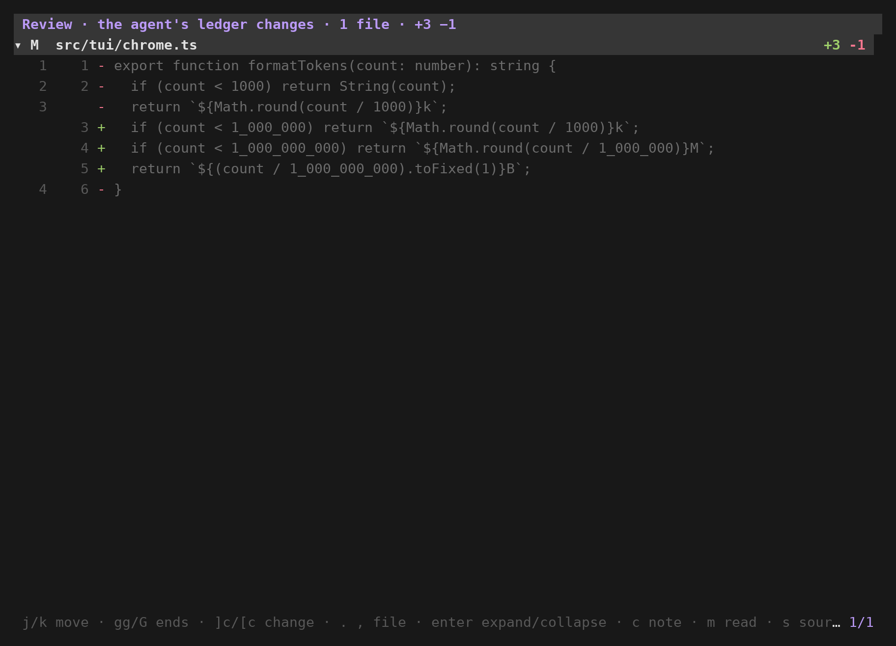
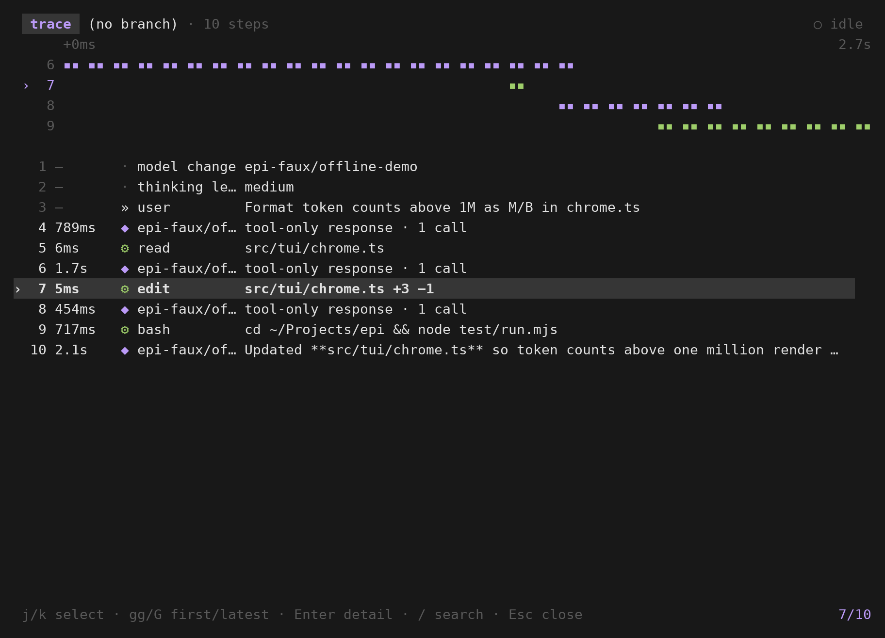

# 0.1.22 特性展示

[← 特性展示](../README.md) · 场景脚本 [scripts/docs/showcase/0.1.22.mjs](../../../scripts/docs/showcase/0.1.22.mjs) · 宣发文案 [announce.md](announce.md)

0.1.22 重新排了对话区：一轮对话是一条脊柱，工具调用各占一行，正文按 76 列排版。到这个版本，配置装配、子任务、MCP、Hooks、文件预览、审查和执行轨迹都已齐备，是第一个可以当日常主力的版本。设计见 [tui-transcript-layout-design.md](../../tui-transcript-layout-design.md)。

演示内容：让 agent 把超过一百万的 token 数显示成 `M` / `B`。它读文件、编辑、跑测试，然后回复；之后依次打开 `/preview`、`/review`、`/trace`。

## 回合脊柱

`spine.mp4` / `spine.gif`：运行中脊柱末端是加粗的 `┃` 和下滑的脉冲；read、edit、bash 各占一行，增删行数和耗时写在行尾，成功不再多一行 `exit 0`；bash 去掉了 `cd ~/Projects/epi &&`；思考折叠成 `∴ 0.3s`；正文限宽，代码块是左侧暗线加 `ts` 标签；`╰─ Worked for` 收尾。

## /preview

`preview.mp4` / `preview.gif`：先看 agent 改过的文件和 diff，`Tab` 切到三栏文件浏览，右栏跟着光标预览，打开 README 是渲染后的 Markdown（标题、引用、列表、表格）。

| 文件浏览 | Markdown 查看器 |
|---|---|
|  |  |

## /review 与 /trace

| `/review`：agent 改了什么 | `/trace`：执行了什么、各花多久 |
|---|---|
|  |  |

## 完整导览

`tour.mp4`（约 19 秒）：一轮对话 → `/preview` → `/review` → `/trace`。只出 MP4，GitHub 页面里点开下载播放。

## 文件

| 文件 | 用途 |
|---|---|
| `spine.mp4`、`spine.gif` | 单条短帖，展示脊柱 |
| `preview.mp4`、`preview.gif` | `/preview` 一段 |
| `tour.mp4` | 长帖或 thread 首条 |
| `turn.png`、`preview-files.png`、`preview-markdown.png`、`review.png`、`trace.png` | 多图帖、文档插图 |

模型回复由脚本给出（`offline-demo`），工具真实执行；`/preview` 的图片和视频画面没有录（见 [约定](../README.md#重新生成)）。
