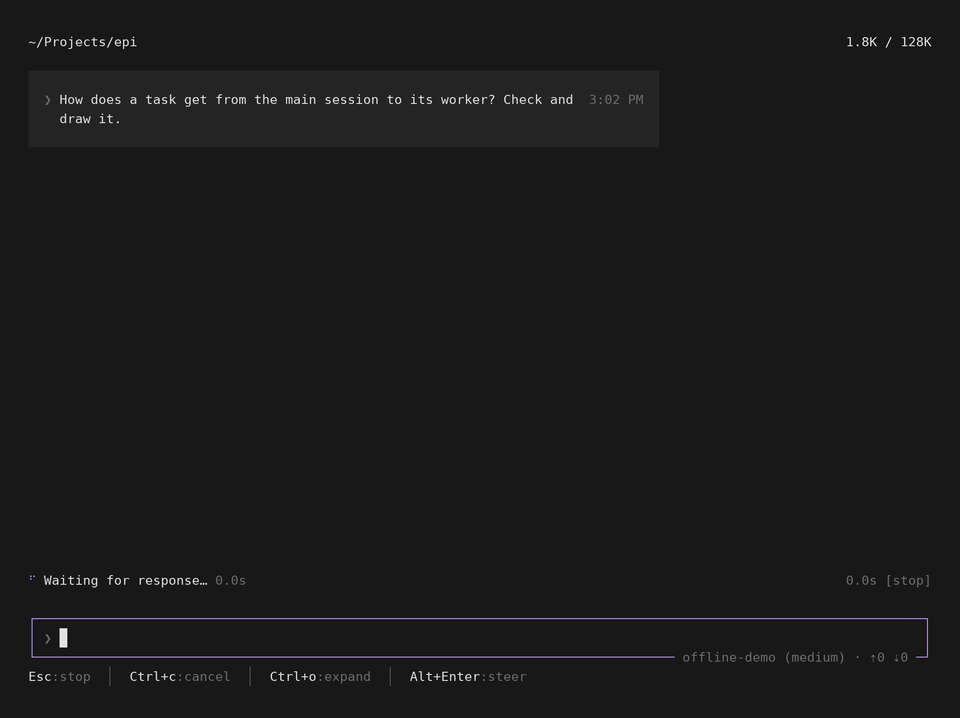
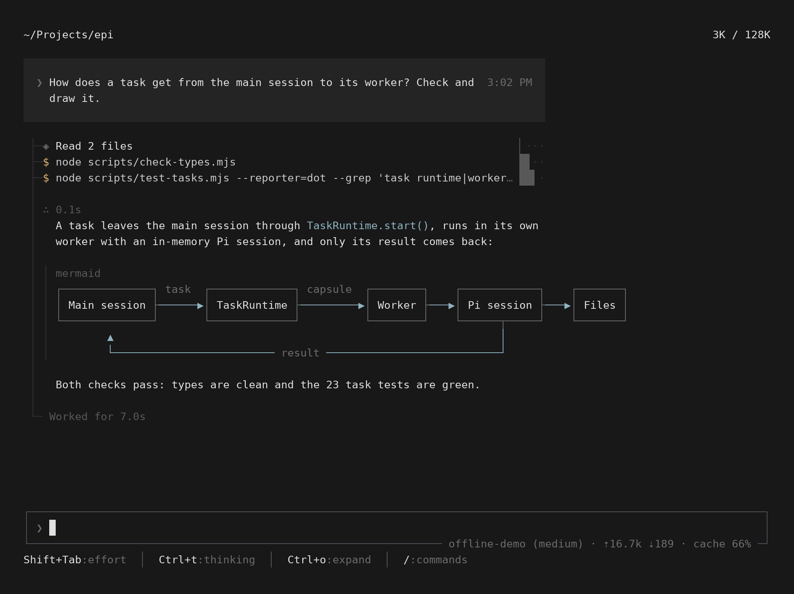

# 0.1.23 特性展示

[← 特性展示](../README.md) · 场景脚本 [scripts/docs/showcase/0.1.23.mjs](../../../scripts/docs/showcase/0.1.23.mjs)

0.1.23 两件事：回复里的 Mermaid 图直接画成框线图；一轮对话排进一列，工具耗时变成这一列右边界上的小条。设计见 [mermaid-design.md](../../mermaid-design.md)、[tui-one-column-design.md](../../tui-one-column-design.md)。

演示内容：问 agent 一个任务怎么从主会话走到 worker。它读两个文件、跑两个检查（一个 0.4 秒，一个 2.6 秒），然后用一张 Mermaid 流程图回答。



- 工具调用的耗时是一个 4 格的条，每格一个数量级（10ms、100ms、1s、10s 起），所有条都在同一列，和你的消息条右端对齐。读两个文件合起来几毫秒，是最细的 `▏`；0.4 秒的检查是一格半；2.6 秒的测试是两格半。运行中的条随时间变长。
- 长命令截在这一列以内，`--grep 'task runtime|worker…` 后面就是条。
- 回复里的 ```` ```mermaid ```` 代码块画成了框线图：方框是暗色，连线用和行内代码一样的灰蓝色，返回的 `result` 连线绕到下方。图表属于数据，不受 76 列正文限宽。



## 文件

| 文件 | 用途 |
|---|---|
| `turn.mp4`、`turn.gif` | 一轮完整对话，约 9 秒 |
| `turn.png` | 结束时的画面 |

模型回复由脚本给出（`offline-demo`），工具真实执行，画面上的耗时是真实测量。终端里块字符画满格子高度，所以相邻几行的条会上下相连。
