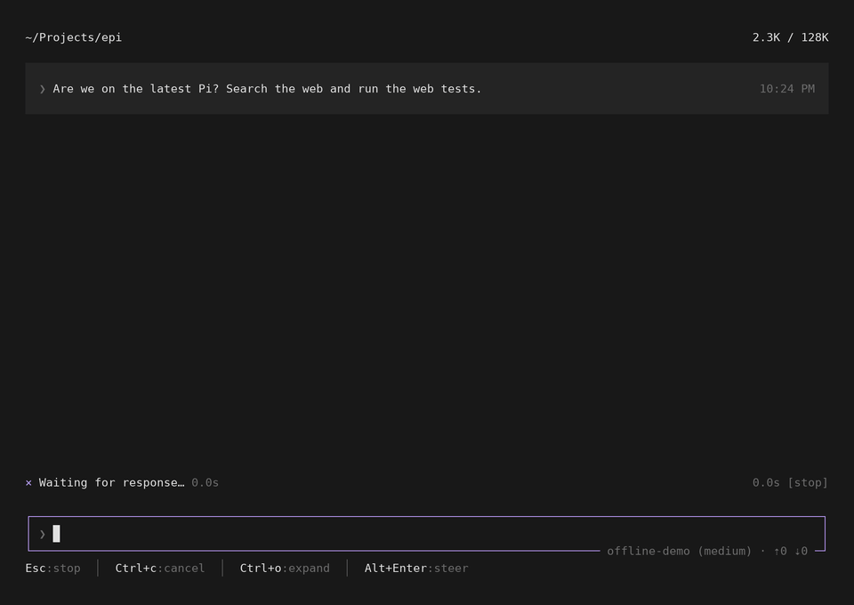
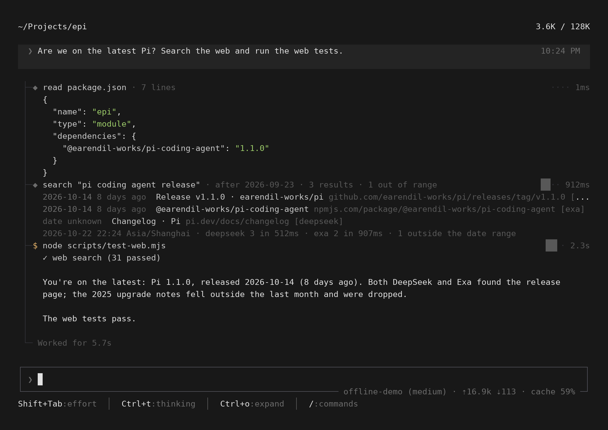

# 0.1.24 特性展示

[← 特性展示](../README.md) · 场景脚本 [scripts/docs/showcase/0.1.24.mjs](../../../scripts/docs/showcase/0.1.24.mjs)

0.1.24 三件事：混合网页检索 `epi:web`；统一图标和旋转的 x；对话区改用终端全宽。设计见 [web-search-design.md](../../web-search-design.md)、[tui-glyphs-design.md](../../tui-glyphs-design.md)。

演示内容：问 agent 项目用的 Pi 是不是最新的。它读 `package.json`，用 `web_search` 查最近一个月、按最新排序，再跑测试。

- 运行中的调用，标记列是旋转的 x（`+`、`×` 每 320ms 交替）；结束时抖两下，定格成 `◆` 或琥珀色的 `$`。
- 检索同时查 DeepSeek 和 Exa：两家都找到的发布页合并成一条，标 `[deepseek, exa]`；2025 年的旧文章在「最近一个月」之外，本地复核去掉了，调用行写 `1 out of range`。
- 正文、调用行、耗时条都铺满终端宽度，和输入框同一条右边界。

`Ctrl+O` 展开后，每条结果的日期在最前，最后一行是今天、每个源的命中数和耗时：

## 文件

| 文件 | 用途 |
|---|---|
| `turn.mp4`、`turn.gif` | 一轮完整对话，约 7 秒 |
| `turn.png` | 结束时的画面 |
| `expanded.png` | `Ctrl+O` 展开后的画面 |

模型回复由脚本给出（`offline-demo`）；两个检索接口是本机上的假服务，结果是编的，没有联网、没有用真实 key。`read` 和 `bash` 真实执行，画面上的耗时是真实测量。
