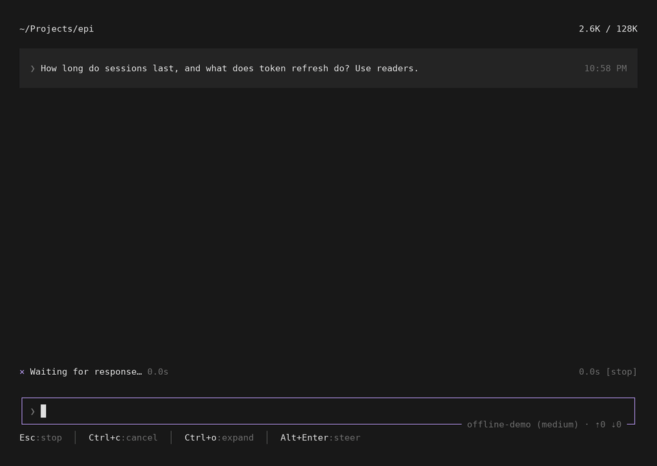
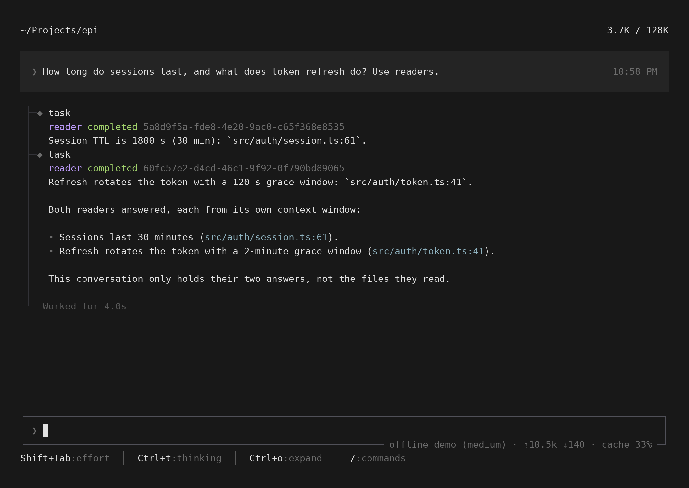

# 0.1.25 特性展示

[← 特性展示](../README.md) · 场景脚本 [scripts/docs/showcase/0.1.25.mjs](../../../scripts/docs/showcase/0.1.25.mjs)

0.1.25 的主题是内置子代理：`epi:task` 2.0 取代外部的 `npm:pi-subagents`。主会话把大块阅读交给子代理，自己只收结论，上下文保持干净。设计与实现状态见 [subagents-design.md](../../subagents-design.md) §10。

演示内容：问两件互不相关的事。模型在同一轮派出两个 `reader` 子代理，它们各自在独立进程、独立上下文里 `grep` 代码，只把带 `文件:行号` 的一句话结论交回来。

- 两个 `task` 调用同一轮发出、同时运行，各自返回结论，不需要 `task_wait`。
- 主会话里只有两句结论，不包含子代理读过的文件。

`Ctrl+O` 展开后，每个子代理的回答显示在它的调用下面：

## 文件

| 文件 | 用途 |
|---|---|
| `turn.mp4`、`turn.gif` | 一轮完整对话，约 5 秒 |
| `turn.png` | 结束时的画面 |
| `expanded.png` | `Ctrl+O` 展开后的画面 |

模型回复由脚本给出（`offline-demo`，主会话和子代理都是它）。每个子代理是真实的 Epi worker 进程，`grep` 真实执行在演示项目上，画面上的耗时是真实测量。
