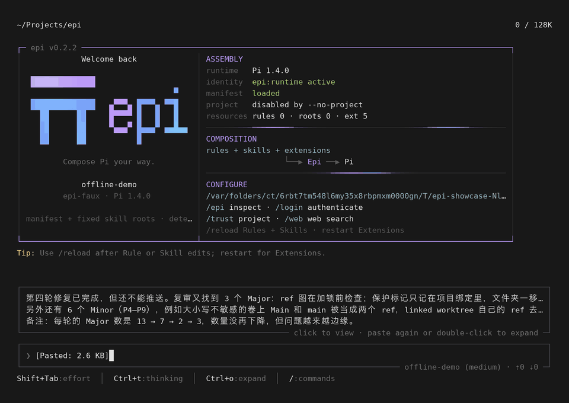
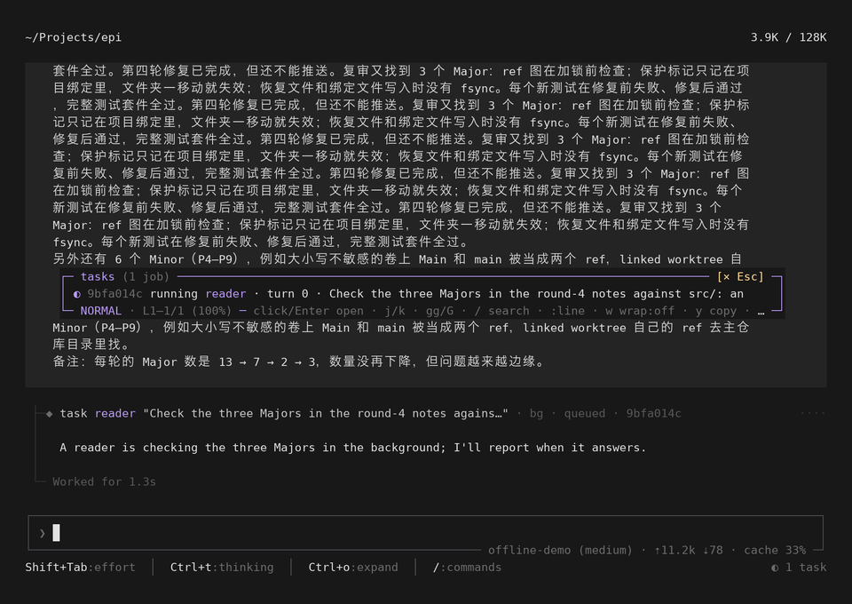

# 0.2.2 特性展示

[← 特性展示](../README.md)

0.2.2 的主题是**长文和子代理都能点开看全**。交互先做成可交互 HTML 原型 [`fold-view-tasks-prototype.html`](../../../scripts/probes/fold-view-tasks-prototype.html)，用户试过同意后才实现（决策 WF6）。设计见 [tui-design.md](../../tui-design.md) §4.3、[subagents-design.md](../../subagents-design.md) §12，问题记录 D95。

- **长文折成标签**：一次粘贴 ≥4 行，或超过 1000 个字符，就折成 `[Pasted: 46 lines]` / `[Pasted: 3.9 KB]`。以前要到 10 KB 才折，几段长文会原样占满输入框。
- **单击浮窗看全文**：光标在标签上时，输入框上方的预览浮窗写着 `click to view`。单击它，在查看器里看全文：自动折行、行号、`j`/`k`、`/` 搜索、`y` 复制。
- **按 `e` 编辑**：查看器里按 `e` 打开编辑框，Enter 保存后放回原位；仍够长就还是一个标签，一次撤销恢复原文。
- **发出的长消息**：显示 `… +N lines (click to view)`，单击看全文。

- **任务页**：单击 `task` 行、单击右下角的 `◐ 1 task`，或输入 `/tasks`，就能看子代理在做什么：状态、轮数、正在做的事，以及它的完整对话（读它自己的会话文件），跑的时候实时刷新。
- **列表**：多个任务时先看列表，最新的在上面；单击一行进入，Esc 返回。

## 文件

| 文件 | 内容 |
|---|---|
| `paste.mp4` / `paste.gif` | 粘贴三段长文 → `[Pasted: 3.3 KB]` → 单击浮窗 → 查看器里滚动 |
| `tasks.mp4` / `tasks.gif` | 发出后模型派一个后台 reader → 单击底栏任务计数 → 列表 → 任务页实时长出新内容 → 单击 task 行再次打开 |
| `chip.png` | 输入框里的标签和预览浮窗 |
| `viewer.png` | 查看器里的全文（折行、行号） |
| `list.png` | `/tasks` 列表 |
| `running.png` / `job.png` | 任务页：运行中、完成后（停在末尾、跟着新内容走） |
| `turn.png` | 一轮结束后的对话 |

> 模型回复是脚本写好的（`offline-demo`）。子代理是真实的 Epi worker 进程，`grep` 和 `read` 真实执行。由 `node scripts/docs/capture-showcase.mjs 0.2.2` 生成，场景脚本 `scripts/docs/showcase/0.2.2.mjs`。
